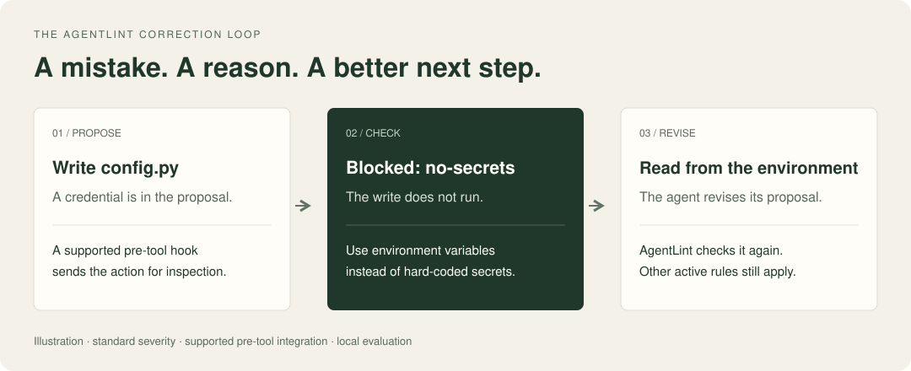

# AgentLint

**Catch risky actions while your coding agent works.**

AgentLint checks proposed file changes and shell commands locally. It blocks detected secret writes and plain force-pushes to `main` or `master`, warns about risky operations, and gives your agent feedback it can act on.

[](https://pypi.org/project/agentlint/)
[](https://github.com/mauhpr/agentlint/actions/workflows/ci.yml)
[](https://pepy.tech/projects/agentlint)
[](https://pypi.org/project/agentlint/)
[](https://opensource.org/licenses/MIT)

[Quickstart](https://mauhpr.github.io/agentlint/quickstart/) · [Documentation](https://mauhpr.github.io/agentlint/) · [Integration coverage](https://mauhpr.github.io/agentlint/coverage/) · [Rules](https://mauhpr.github.io/agentlint/rules/)



*Illustration with a supported pre-tool hook and standard policy. AgentLint evaluates the revised proposal again; it does not rewrite your code itself.*

## See the difference

A coding agent proposes putting a credential in `config.py`. The `no-secrets` rule denies the write and returns a reason:

```text
[no-secrets] Secret assignment detected: api_key=...
  -> Use environment variables instead of hard-coded secrets.
```

The agent can replace the literal with an environment-variable lookup:

```python
import os

api_key = os.environ["SERVICE_API_KEY"]
```

The credential finding is resolved. The revised action is checked against the active policy, and any other findings still apply.

[Watch the 53-second product overview](https://mauhpr.github.io/agentlint/media/agentlint-demo.mp4). The demonstration evaluates synthetic proposed actions as data; it does not execute dangerous commands.

## Get started

Requires Python 3.11+ and [pipx](https://pipx.pypa.io/stable/installation/) or [uv](https://docs.astral.sh/uv/getting-started/installation/).

```bash
uv tool install agentlint
cd your-project
agentlint setup claude
```

Use your agent's name for the last command:

| Agent | Setup | Activate |
|-------|-------|----------|
| [Claude Code](https://mauhpr.github.io/agentlint/agents/claude/) | `agentlint setup claude` | Restart Claude Code |
| [Codex](https://mauhpr.github.io/agentlint/agents/codex/) | `agentlint setup codex` | Restart, then review and trust the hooks in `/hooks` |
| [Cursor](https://mauhpr.github.io/agentlint/agents/cursor/) | `agentlint setup cursor` | Reload the Cursor window |
| [Gemini CLI](https://mauhpr.github.io/agentlint/agents/gemini/) | `agentlint setup gemini` | Start a new session |
| [Continue](https://mauhpr.github.io/agentlint/agents/continue/) · [Kimi](https://mauhpr.github.io/agentlint/agents/kimi/) · [Grok](https://mauhpr.github.io/agentlint/agents/grok/) | `agentlint setup continue`, `kimi`, or `grok` | Follow the linked agent guide |

Prefer pipx? Use `pipx install agentlint` instead. Setup adds hooks to your agent's settings and creates `agentlint.yml` if it does not exist, using packs detected from the project.

Make one tool call in your agent, then run:

```bash
agentlint status
```

Look for a recent **observed** hook call from this project. A configuration file alone does not prove the hooks are running. If nothing is observed, run `agentlint doctor` and follow [troubleshooting](https://mauhpr.github.io/agentlint/diagnostics/).

The [five-minute quickstart](https://mauhpr.github.io/agentlint/quickstart/) completes the first check and correction. Claude Code users can alternatively install the [marketplace plugin](https://github.com/mauhpr/agentlint-plugin); use the plugin or native setup to avoid duplicate hooks.

## What blocks, what warns

With standard severity and the relevant pre-tool hook:

| Outcome | Examples | Requirement |
|---------|----------|-------------|
| **Block** | Detected secret writes, `.env` writes, plain `--force`/`-f` pushes to `main`/`master`, CI pipeline edits, package publishing | Core rules, subject to configuration and each rule's scope |
| **Warn** | Many destructive commands, direct pushes to `main`, protected-branch `--force-with-lease`, test weakening, removed error handling | Core rules; some catastrophic destructive patterns block instead |
| **Check your stack** | SQL interpolation, unsafe Python shell calls, frontend accessibility, React loading states | Detected language/framework packs |
| **Opt in** | Shell file-write restrictions and network exfiltration checks | `security` pack |
| **Opt in, experimental** | Production targets, cloud deletions, infrastructure mutations | `autopilot` pack |

Some rules run after a tool call or at session end and cannot prevent an action that has already happened. Severity settings, approvals, exemptions, and the circuit breaker affect decisions. The [rule reference](https://mauhpr.github.io/agentlint/rules/) documents the exact behavior.

**Integration matters.** Native hooks inspect the tools their host reports. The [OpenAI Agents SDK adapter](https://mauhpr.github.io/agentlint/agents/openai-agents/) must be attached to supported tools. The [MCP server](https://mauhpr.github.io/agentlint/agents/mcp-hosts/) provides on-demand checks and is advisory. See [coverage and limitations](https://mauhpr.github.io/agentlint/coverage/) before relying on an integration.

## Make it fit your project

```yaml
# agentlint.yml
packs: [python, security]  # explicit selection; core packs are also loaded
rules:
  max-file-size:
    limit: 400
  no-todo-left:
    enabled: false
```

An explicit `packs` list replaces stack detection. The `universal` and `quality` packs are included unless deliberately excluded. Start with detected defaults and add stricter packs when you need them.

| You want to… | Start here |
|--------------|------------|
| Protect a shared branch while keeping normal Git work moving | [Protect main](https://mauhpr.github.io/agentlint/guides/protect-main/) |
| Fix a legitimate action that keeps getting flagged | [Handle a false positive](https://mauhpr.github.io/agentlint/guides/fix-a-false-positive/) |
| Run Ruff, ESLint, or a formatter after agent edits | [Connect your linters](https://mauhpr.github.io/agentlint/guides/run-linters/) |
| Apply a shared policy across repositories | [Share required rules](https://mauhpr.github.io/agentlint/guides/shared-policy/) |
| Enforce a convention specific to your codebase | [Write a custom rule](https://mauhpr.github.io/agentlint/custom-rules/) |

## Use the same checks beyond the agent

```bash
agentlint check-patch change.patch       # preview a Codex patch without applying it
agentlint ci --diff origin/main...HEAD   # check the pull request's file changes
agentlint evidence                      # inspect verification receipts
```

CI checks file changes; it does not reconstruct or audit every shell command the agent ran. [CI setup](https://mauhpr.github.io/agentlint/ci/) · [CLI reference](https://mauhpr.github.io/agentlint/cli/)

## Local by default

Hook checks run locally. You do not need an account or a network connection for the offline rules. Optional [AgentChute](https://mauhpr.github.io/agentlint/agentchute/) adds threat feeds, team policy, and visibility; feed-backed rules need that data. Cloud event delivery is opt-in and sends redacted summaries rather than file contents or full commands.

AgentLint uses rules and heuristics. It can miss risky behavior, flag legitimate work, and be bypassed by a process with broad access. Keep code review, tests, CI, and least-privilege credentials in place. [Security model](https://mauhpr.github.io/agentlint/coverage/#security-boundary) · [Report a vulnerability](https://github.com/mauhpr/agentlint/security/advisories/new)

## Contribute

Start with [CONTRIBUTING.md](https://github.com/mauhpr/agentlint/blob/main/CONTRIBUTING.md). A regression case for a false positive or a missed detection is a useful first contribution. AgentLint includes 77 built-in rules in 8 packs; the [catalogue](https://mauhpr.github.io/agentlint/rules/) is generated in part from the code and checked in CI.

[Changelog](https://github.com/mauhpr/agentlint/blob/main/CHANGELOG.md) · [Issues](https://github.com/mauhpr/agentlint/issues) · [Security policy](https://github.com/mauhpr/agentlint/blob/main/SECURITY.md) · [MIT license](https://github.com/mauhpr/agentlint/blob/main/LICENSE)

## Star history

[](https://www.star-history.com/#mauhpr/agentlint&Date)
